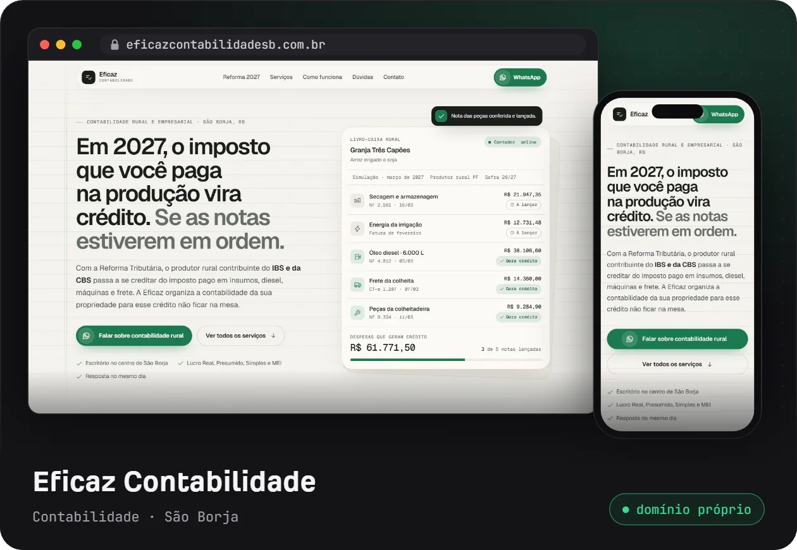
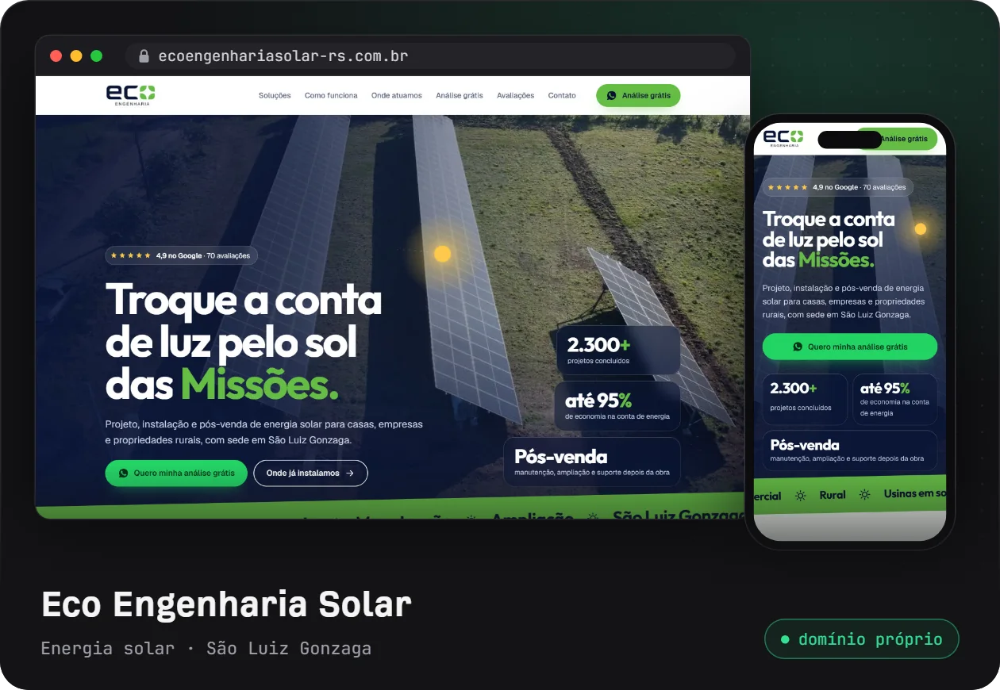
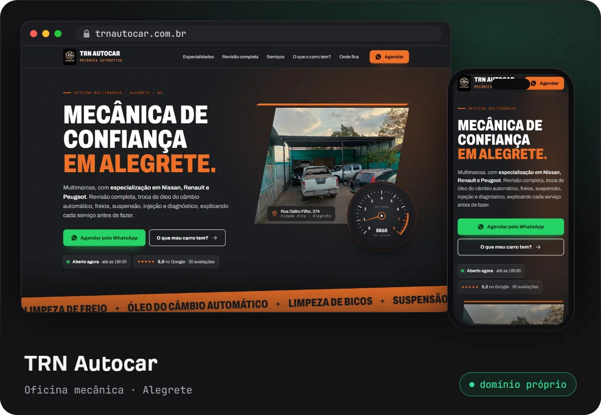
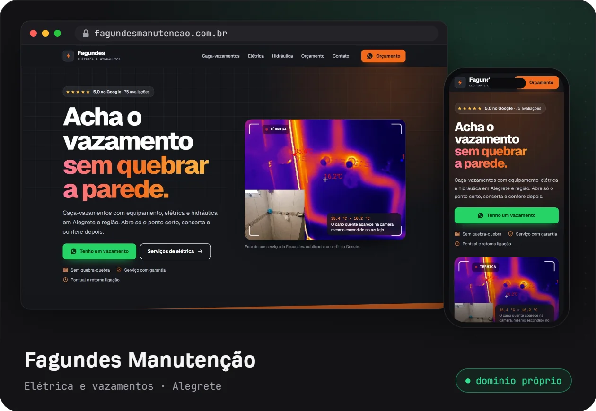
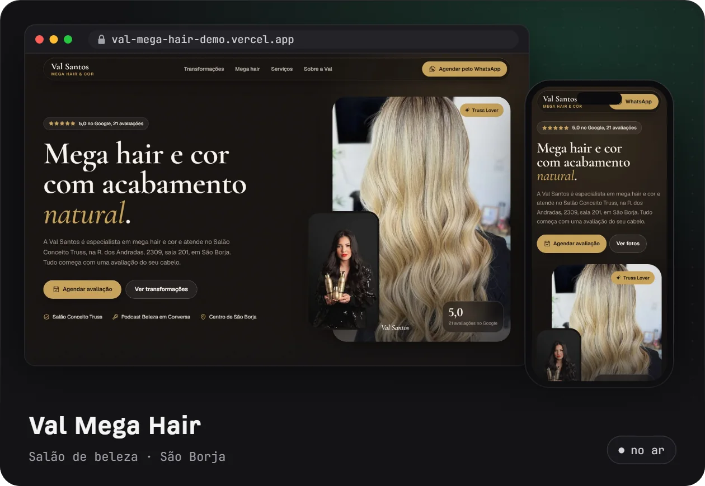
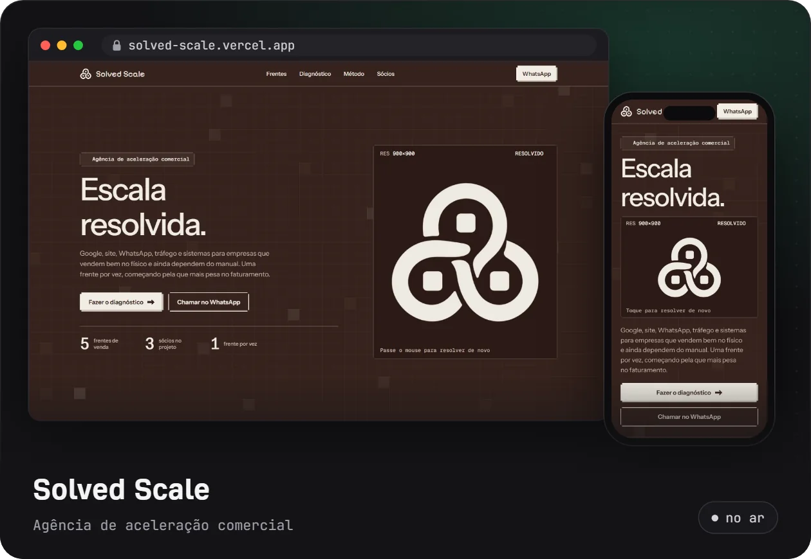
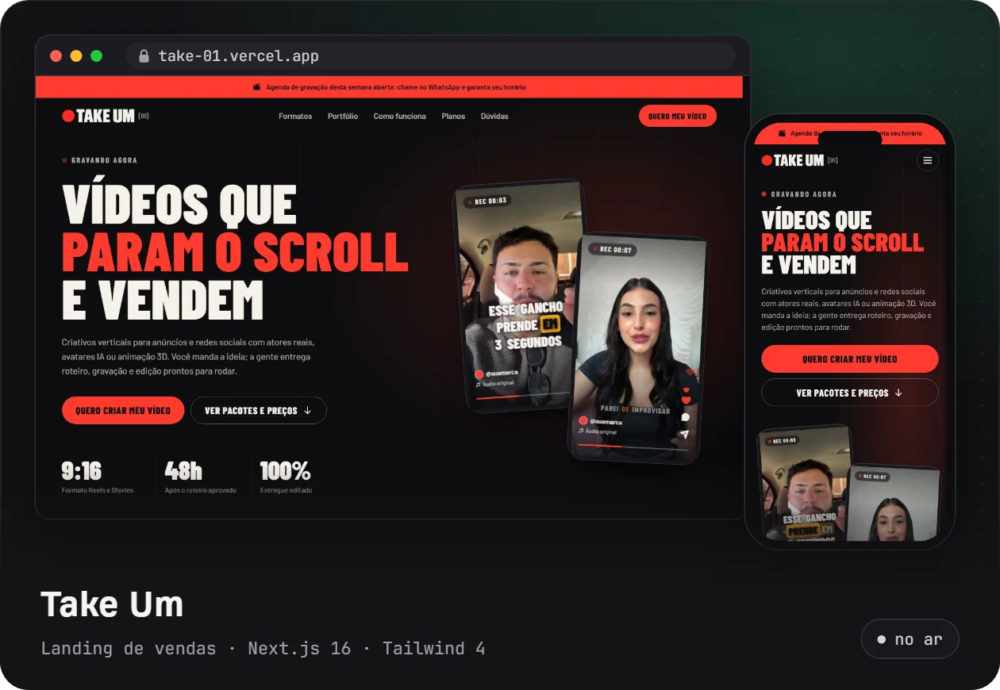
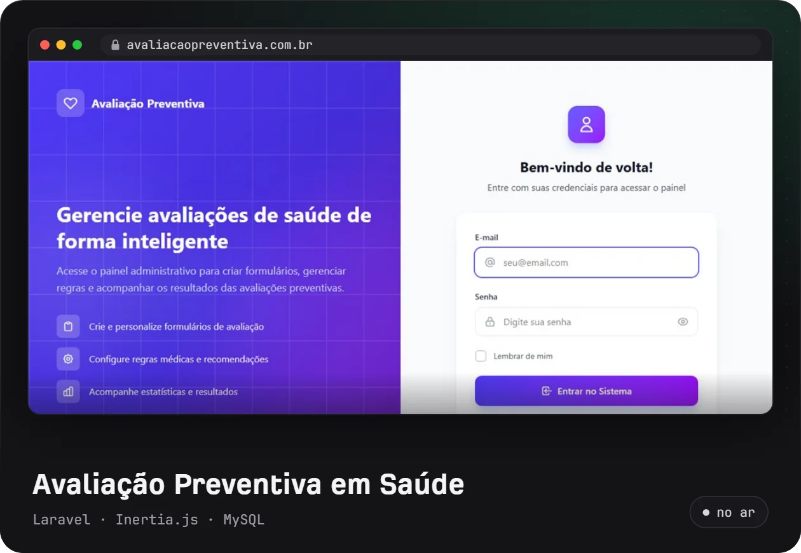
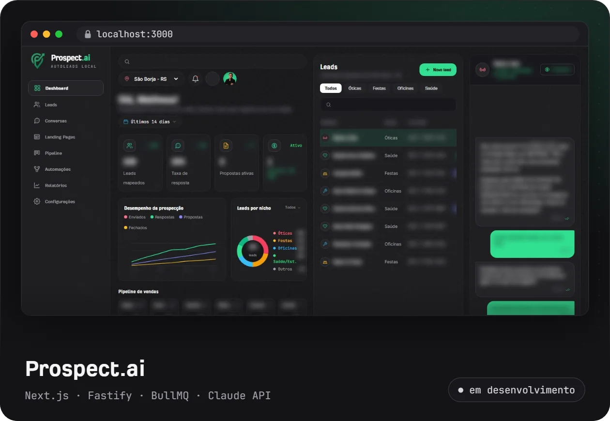

<picture>
  <source media="(prefers-color-scheme: dark)" srcset="assets/header-dark.svg">
  <source media="(prefers-color-scheme: light)" srcset="assets/header-light.svg">
  
</picture>

Sou desenvolvedor full stack e **Analista de TI no Hospital Ivan Goulart**, em São Borja (RS), formado em Ciência da Computação pela URI. No hospital, desenvolvo sistemas internos em Laravel e React e faço parte da equipe que cuida dos servidores e bancos de dados onde eles rodam.

Também faço páginas para negócios do interior gaúcho: oficinas, salões, contabilidade, energia solar. Cada uma usa as fotos reais do negócio, ganha domínio próprio, é configurada no Google e leva o cliente direto para o WhatsApp.

## Clientes no ar

  
  

  
  

  
  

## Projetos

  
  

  
  

- **Solved Scale**: agência que fundei com dois sócios para ajudar empresas a vender mais, com site, automação e tráfego. Fiz o site, com a marca e a animação do logo.
- **[Take Um](https://github.com/MatheusMattos-Dev/take-um)**: landing de vendas de uma produtora de vídeos verticais, em Next.js 16, Tailwind CSS 4 e Motion.
- **Avaliação Preventiva em Saúde**: cruza o perfil do paciente com diretrizes clínicas oficiais e recomenda exames, vacinas e hábitos. Laravel, Inertia.js e MySQL.
- **Prospect.ai** *(em desenvolvimento)*: lê as conversas do WhatsApp Business, classifica o interesse com IA e monta uma página para cada negócio. Nada sai sem aprovação humana.

## Stack

<picture>
  <source media="(prefers-color-scheme: dark)" srcset="assets/stack-dark.svg">
  <source media="(prefers-color-scheme: light)" srcset="assets/stack-light.svg">
  
</picture>

## Trajetória

| Quando | Onde | O quê |
| --- | --- | --- |
| 2025 – hoje | Hospital Ivan Goulart | Analista de TI: sistemas internos, servidores e bancos de dados |
| 2026 | SENAC-RS | Professor de noções de TI e programação |
| 2024 – 2025 | Método Ambiental | Desenvolvedor full stack em Laravel |
| 2024 | Nosso Mercado | Gerente de TI |
| 2021 – 2023 | PUC-RS | Programador front-end da plataforma de ensino a distância |
| 2020 – 2021 | Compass UOL | Estágio em front-end no projeto da Vivo |

Bacharel em Ciência da Computação pela URI (2019 – 2023) e técnico em Informática.

## Atividade

<picture>
  <source media="(prefers-color-scheme: dark)" srcset="https://raw.githubusercontent.com/MatheusMattos-Dev/MatheusMattos-Dev/output/snake-dark.svg">
  <source media="(prefers-color-scheme: light)" srcset="https://raw.githubusercontent.com/MatheusMattos-Dev/MatheusMattos-Dev/output/snake-light.svg">
  
</picture>

## Contato

  
  
  

